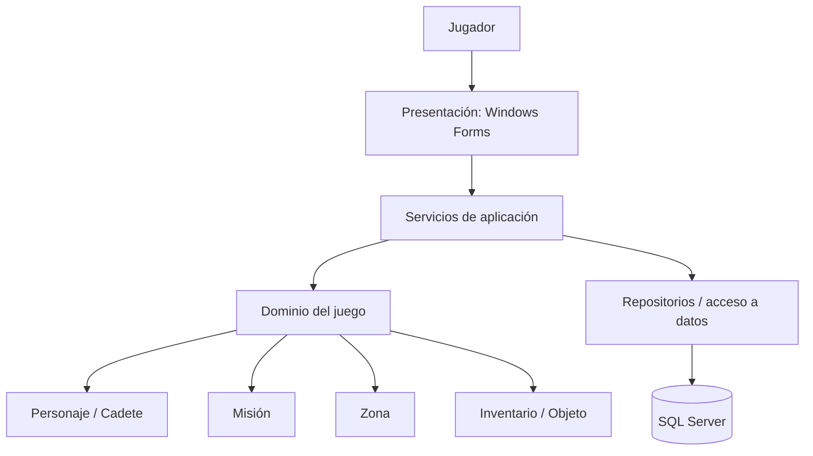

# Arquitectura propuesta para NEXUS

## 1. Objetivo

Evolucionar el juego de consola de H3 hacia una aplicación de escritorio Windows Forms, conservando las reglas del juego y agregando persistencia SQL Server. Se recomienda una separación lógica en tres capas para evitar que la interfaz dependa directamente de la base de datos.

## 2. Diagrama



### Responsabilidades

- **Presentación (`Nexus.UI`):** formularios y controles. Muestra datos, captura selección del jugador y presenta mensajes. No debe contener reglas de energía, combate o finalización de misión.
- **Aplicación (`Nexus.Application`):** coordina casos de uso como `IniciarPartida`, `ExplorarZona`, `UsarObjeto`, `ConsultarMision`, `GuardarPartida` y `CargarPartida`.
- **Dominio (`Nexus.Domain`):** reglas y entidades derivadas del H3: `Personaje`, `Cadete`, `Robot`, `Enemigo`, `Objeto`, `Inventario`, `Zona` y `Mision`.
- **Infraestructura (`Nexus.Infrastructure`):** conexión a SQL Server, consultas parametrizadas, transacciones y repositorios.
- **Base de datos:** guarda datos persistentes del jugador y del progreso. No debe almacenar la lógica de negocio como procedimientos opacos que la aplicación no pueda probar.

## 3. Estructura de solución sugerida

```text
NEXUS/
├── NEXUS.sln
├── src/
│   ├── Nexus.UI/                 # Windows Forms
│   ├── Nexus.Application/        # casos de uso y servicios
│   ├── Nexus.Domain/             # reglas y entidades
│   └── Nexus.Infrastructure/     # SQL Server y repositorios
├── docs/
└── README.md
```

La reorganización debe hacerse por etapas. No es obligatorio mover todo el código en un único commit. Si la solución actual es un único proyecto, primero separar las clases en archivos dentro del proyecto existente y mantener una compilación funcional.

## 4. Flujo de ejemplo: usar objeto

1. El jugador selecciona un objeto en `FrmInventario`.
2. El formulario llama a `JuegoService.UsarObjeto(idObjeto)`.
3. El servicio solicita al dominio validar el objeto y actualizar al cadete.
4. El servicio guarda el nuevo estado mediante `IPartidaRepository`.
5. El formulario actualiza barras, lista de objetos y mensaje de resultado.
6. Si el guardado falla, se informa al jugador y se aplica una estrategia definida para evitar presentar como guardado un progreso que no lo está.

## 5. Formularios propuestos

| Formulario | Función |
|---|---|
| `FrmMenuPrincipal` | Nueva partida, continuar, documentación y salir. |
| `FrmExploracion` | Zonas, descripción, estado y acción de explorar. |
| `FrmMisiones` | Objetivos pendientes/completados. |
| `FrmExploradorInventario` | Vida, energía, experiencia y objetos disponibles. |
| `FrmGuardarPartida` (opcional) | Nombre de partida y confirmación de guardado. |

## 6. Reglas de implementación

- Usar eventos de controles para llamar a servicios, no para duplicar las reglas del juego.
- Usar parámetros SQL, nunca concatenar texto del jugador dentro de consultas.
- Centralizar configuración de conexión y excluir secretos del control de versiones.
- Mantener la UI receptiva; si las operaciones de datos tardan, considerar operaciones asíncronas.
- Crear pruebas de dominio para energía, daño, uso de objetos y finalización de misión.
- Aplicar migraciones o scripts SQL versionados para reproducir el esquema.
