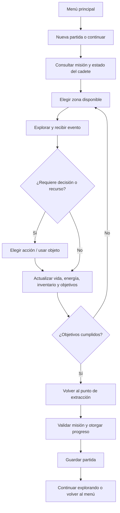

# NEXUS — Diseño del videojuego (propuesta)

**Versión documental:** 1.0  
**Base:** NEXUS v1.0 — Exploración de realidades, Hito 3  
**Plataforma objetivo:** escritorio Windows, C# Windows Forms y SQL Server.

## 1. Visión del juego

NEXUS es una aventura de exploración de ciencia ficción ambientada en el año 2297. El jugador controla a un cadete enviado a investigar una anomalía que amenaza la estabilidad de una realidad. La versión de H3 ya contempla un cadete con vida, energía, experiencia e inventario; zonas como Bosque de Cristal, Ruinas de IRIS, Zona de Anomalía y Punto de Extracción; personajes como robots y enemigos; y la misión “La anomalía perdida”.

La versión gráfica convertirá las opciones de consola en pantallas visuales claras. El jugador recorrerá zonas, revisará señales, administrará energía y objetos, sobrevivirá a encuentros y completará objetivos antes de volver al punto de extracción. La motivación será descubrir qué ocurrió en IRIS, obtener recursos, mejorar el progreso y completar la misión sin perder al cadete.

**Principio de diseño:** la interfaz presenta el estado y las opciones, pero las reglas del juego siguen perteneciendo a la lógica de NEXUS, no a los botones del formulario.

## 2. Ciclo principal de juego



## 3. Mecánicas y reglas

### Explorador y estado
- El personaje controlado es `Cadete`, derivado de `Personaje`.
- El punto inicial documentado por H3 es 100 de vida, 60 de energía y 0 de experiencia.
- La energía no puede bajar de 0 ni superar 100 en la implementación consultada.
- El daño reduce la vida y la limita a un mínimo de 0. En la versión gráfica se mostrará con barras y números.
- La experiencia se conserva como progreso del jugador. Los niveles y mejoras son una ampliación opcional, no una función que deba darse por implementada.

### Zonas y exploración
- Las zonas base son Bosque de Cristal, Ruinas de IRIS, Zona de Anomalía y Punto de Extracción.
- La pantalla de mapa mostrará descripción, estado de descubrimiento y acciones disponibles.
- En H3, `Zona` representa nombre y descripción; el mapa visual y el desplazamiento entre zonas son una propuesta futura.
- El recorrido debe respetar el orden lógico de la misión y permitir regresar a extracción.

### Misión
La misión existente “La anomalía perdida” tiene cuatro condiciones: llegar a la anomalía, encontrar el núcleo energético, sobrevivir al encuentro y regresar. La misión se marca completa únicamente cuando se cumplen las cuatro condiciones. La interfaz mostrará cada objetivo como pendiente o completado.

### Inventario y objetos
- `Inventario` mantiene una colección de objetos.
- `Objeto` incluye nombre, tipo y poder.
- Los tipos previstos en el código incluyen energía, escudo, ataque y analizador.
- Al usar un objeto, se valida el índice seleccionado; los objetos consumibles se retiran después del uso según la lógica actual.
- La versión gráfica mostrará nombre, tipo, poder y acción disponible. Debe dar retroalimentación al usar o no poder usar un objeto.

### Encuentros
Los personajes comparten una base `Personaje` y ejecutan su comportamiento mediante `Actuar(Cadete cadete)`. En el código revisado, el enemigo causa daño al cadete y el robot tiene su propia clase. Los encuentros visuales y opciones tácticas ampliadas son futuras mejoras.

## 4. Bocetos de pantallas (wireframes)

Los bocetos son conceptuales, no interfaces funcionales. Las ubicaciones de los controles podrán ajustarse durante la implementación.

### Pantalla A — Menú principal

```text
┌──────────────────────────────────────────────────────────────────┐
│ NEXUS // EXPLORACIÓN DE REALIDADES                 v1.0           │
├──────────────────────────────────────────────────────────────────┤
│                                                                  │
│                      N E X U S                                   │
│              “La anomalía perdida”                               │
│                                                                  │
│              [ NUEVA PARTIDA ]                                   │
│              [ CONTINUAR      ]                                  │
│              [ DOCUMENTACIÓN  ]                                  │
│              [ SALIR          ]                                  │
│                                                                  │
│ Estado: partida nueva / progreso guardado                        │
└──────────────────────────────────────────────────────────────────┘
```

**Navegación:** Nueva partida crea el estado inicial del cadete; Continuar carga una partida guardada si existe; Documentación abre ayuda; Salir cierra la aplicación con confirmación si hay cambios pendientes.

### Pantalla B — Exploración / mapa

```text
┌──────────────────────────────────────────────────────────────────┐
│ NEXUS > MAPA                           Vida ████████░  Energía 60│
├─────────────────────┬────────────────────────┬───────────────────┤
│ ZONAS               │ MAPA / ZONA ACTUAL     │ INFORMACIÓN       │
│ > Bosque de Cristal │   [Bosque]──[Ruinas]    │ Bosque de Cristal │
│   Ruinas de IRIS    │                \        │ Señales energéticas│
│   Zona de Anomalía  │             [Anomalía]  │ Riesgo: por evaluar│
│   Punto de Extracción│               |        │                   │
│                     │          [Extracción]   │ [Explorar zona]   │
├─────────────────────┴────────────────────────┴───────────────────┤
│ [Misión] [Inventario] [Estado] [Volver al menú]                  │
│ Mensaje: “Se detecta una señal al este.”                         │
└──────────────────────────────────────────────────────────────────┘
```

**Navegación:** seleccionar una zona muestra su descripción y las acciones permitidas. Explorar actualiza el estado de la partida mediante la lógica del juego; los controles no deben modificar directamente las tablas SQL.

### Pantalla C — Misiones

```text
┌──────────────────────────────────────────────────────────────────┐
│ NEXUS > MISIONES                                                 │
├──────────────────────────────────────────────────────────────────┤
│ MISIÓN ACTIVA: La anomalía perdida                               │
│                                                                  │
│ [✓] Llegar a la zona de anomalía                                 │
│ [ ] Encontrar el núcleo energético                               │
│ [ ] Sobrevivir al encuentro                                      │
│ [ ] Regresar al punto de extracción                              │
│                                                                  │
│ Progreso: 1 de 4 objetivos                                       │
│                                                                  │
│ [Ir al mapa] [Guardar partida] [Volver]                          │
└──────────────────────────────────────────────────────────────────┘
```

**Navegación:** la pantalla consulta el objeto `Mision`; el jugador puede volver al mapa o guardar. El porcentaje de progreso se calcula a partir de los objetivos reales, no se almacena como un valor independiente si puede derivarse.

### Pantalla D — Explorador e inventario

```text
┌──────────────────────────────────────────────────────────────────┐
│ NEXUS > EXPLORADOR / INVENTARIO                                  │
├──────────────────────────────┬───────────────────────────────────┤
│ CADETE                       │ INVENTARIO                        │
│ Vida       ██████████ 100    │ 1. Célula de energía | +25        │
│ Energía    ██████░░░░ 60     │ 2. Escudo portátil   | +20        │
│ Experiencia       0 XP       │ 3. Analizador                     │
│                              │                                   │
│ [Ver estado completo]        │ Seleccionado: Célula de energía   │
│                              │ [Usar objeto] [Detalles]          │
├──────────────────────────────┴───────────────────────────────────┤
│ Mensaje: “Energía recuperada: +25”                               │
│ [Mapa] [Misiones] [Volver]                                       │
└──────────────────────────────────────────────────────────────────┘
```

**Navegación:** seleccionar un objeto muestra sus detalles; Usar objeto valida que la selección sea válida y actualiza el estado; el resultado se muestra en un mensaje visible.

## 5. Experiencia de usuario

- **Legibilidad:** tipografía clara, contraste suficiente y texto breve; no depender solo del color para mostrar estados.
- **Jerarquía:** título de pantalla, estado del cadete, contenido principal y acciones secundarias en ese orden.
- **Consistencia:** mismos nombres, iconos y posiciones para Mapa, Misiones, Inventario, Guardar y Volver.
- **Navegación:** el usuario debe poder volver al menú sin perder progreso y debe recibir confirmación antes de descartar cambios.
- **Retroalimentación:** toda acción produce un mensaje de éxito, advertencia o error; por ejemplo, objeto usado, energía insuficiente o zona no disponible.
- **Accesibilidad básica:** controles con texto, navegación por teclado, tamaños legibles y estados seleccionados visibles.
- **Prevención de errores:** desactivar acciones imposibles y validar entradas antes de modificar el estado.

## 6. Alcance y restricciones

### Prioridad obligatoria (primera versión gráfica)
1. Mantener la misión y las cuatro zonas base de H3.
2. Presentar menú, mapa/lista de zonas, misiones, estado del cadete e inventario.
3. Separar formularios de las reglas del juego.
4. Guardar y cargar progreso básico con SQL Server.
5. Validar uso de objetos, energía y estados de misión.
6. Mantener el proyecto compilable y documentado en GitHub.

### Opcional
- Animaciones, efectos de sonido y música.
- Árbol de habilidades, niveles, más misiones y nuevos mapas.
- Combate táctico con varias opciones.
- Perfiles múltiples y estadísticas históricas.

### Restricciones
- La base obligatoria es el código de H3; no se debe afirmar que las funciones propuestas ya están implementadas.
- La plataforma prevista es Windows Forms en C# con SQL Server.
- La persistencia se añadirá después del diseño y la separación de responsabilidades.
- No guardar contraseñas ni credenciales de conexión en el repositorio.
- Evitar reemplazar el código actual antes de contar con una versión de referencia que compile.
- Los bocetos representan una propuesta de interfaz; no son formularios funcionales.
