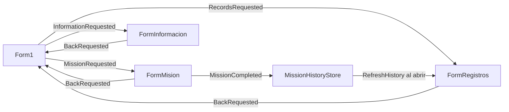

# Arquitectura actual de NEXUS

## Alcance y solución activa

La solución principal es `NEXUS.slnx`, que referencia únicamente `NEXUS_WindowsForms/NEXUS_WindowsForms.csproj`. Ese proyecto es una aplicación Windows Forms (`WinExe`) dirigida a `net10.0-windows`. El proyecto de consola `nexus1.2mrj.csproj` y su `Program.cs` siguen en el repositorio, pero quedan fuera de la solución principal.

Esta página describe el código local de Windows Forms. Las clases de consola (`Cadete`, `Zona`, `Mision`, etc.) son parte del prototipo anterior y no son dependencias de la misión gráfica.

## Organización

| Archivo o tipo | Responsabilidad actual |
|---|---|
| `Program.cs` (WinForms) | Inicializa la configuración de Windows Forms y ejecuta `NexusApplicationContext`. |
| `NexusApplicationContext` | Crea y conserva una instancia de cada formulario; conecta eventos de navegación y misión; muestra una sola pantalla; gestiona la X, la confirmación de salida y el guardado de resultados. |
| `Form1` | Menú principal. Emite `MissionRequested`, `InformationRequested`, `RecordsRequested` y `ExitRequested`; conserva su diseño en el archivo Designer y recursos existentes. |
| `FormMision` | Construye la interfaz de la misión en código, presenta narrativa, opciones, progreso y recursos, y expone `MissionCompleted` y `LastResult`. |
| `MissionGame` (`Services`) | Mantiene etapa, decisiones, variables de ruta, recursos y condiciones para calcular el desenlace. No presenta controles gráficos. |
| `MissionOption` (`Services`) | Representa el identificador, título y descripción de una opción de misión. Está declarada junto a `MissionGame`. |
| `MissionResult` (`Models`) | Modelo serializable del resultado final de una misión. |
| `MissionHistoryStore` (`Services`) | Carga y guarda la lista de resultados en JSON bajo el perfil local del usuario; maneja fallos y evita guardar dos veces el mismo `Id`. |
| `FormRegistros` | Carga el historial, presenta lista y detalles y comunica una selección vacía o errores de lectura. Recibe el mismo `MissionHistoryStore` que usa el contexto. |
| `FormInformacion` | Presenta secciones de enciclopedia y botones para cambiar de sección. |
| `NexusEncyclopedia` (`Content`) | Contiene títulos, categorías y textos de la enciclopedia; diferencia contenido establecido de ampliación narrativa mediante `IsEstablished`. |
| `NexusTheme` | Centraliza colores y un helper de estilo compartido por pantallas secundarias. |

## Navegación y ciclo de vida

`NexusApplicationContext` crea una única instancia de `Form1`, `FormMision`, `FormInformacion` y `FormRegistros` durante la sesión. No se crean formularios nuevos al navegar:

Al mostrar una pantalla, el contexto oculta las demás y activa la elegida. El botón de volver de cada pantalla secundaria regresa al mismo menú. La X de una pantalla secundaria se trata como volver al menú. Al cerrar el menú, se pregunta si se desea salir; si se confirma, el contexto cierra también las instancias secundarias ocultas. El mensaje advierte que una misión sin finalizar no se guarda.

Al abrir registros, `OpenRecords` solicita una recarga antes de mostrar el formulario, para incluir resultados guardados durante la sesión.

## Misión y datos

`FormMision` solicita opciones a `MissionGame` y envía el identificador seleccionado. `MissionGame` aplica los cambios de recursos y avanza la etapa. Al llegar a una decisión final produce un `MissionResult`; `FormMision` asigna `LastResult` y emite `MissionCompleted`. El contexto entrega el resultado al almacén JSON. Si el guardado falla, presenta un mensaje de error.

`MissionHistoryStore` utiliza `Environment.SpecialFolder.LocalApplicationData` y el archivo `NEXUS/mission-history.json`. `FormRegistros` muestra fecha, desenlace y puntuación en la lista; los detalles incluyen resumen, valores finales y decisiones.

## Interfaz y recursos

Los formularios siguen siendo cuatro clases parciales y conservan sus archivos `Designer.cs` y `.resx`. `Form1` usa recursos visuales del proyecto; hay tres PNG bajo `Resources/` y recursos integrados en `Properties/Resources.resx`. La mayor parte de la interfaz de misión, información e historial se crea desde sus archivos `.cs`; no se usa un servicio externo de datos ni una base SQL.

## Límites actuales

- El contexto de formularios y el estado de una misión viven en memoria durante la ejecución.
- El historial persiste resultados finalizados; no guarda una misión en curso ni permite reanudarla.
- El almacenamiento es local al perfil de Windows, no compartido entre usuarios o equipos.
- El prototipo de consola conserva clases y reglas distintas; no se integra como capa de dominio de la aplicación gráfica.
- No hay pruebas automatizadas ni proyecto de pruebas en la solución actual.
