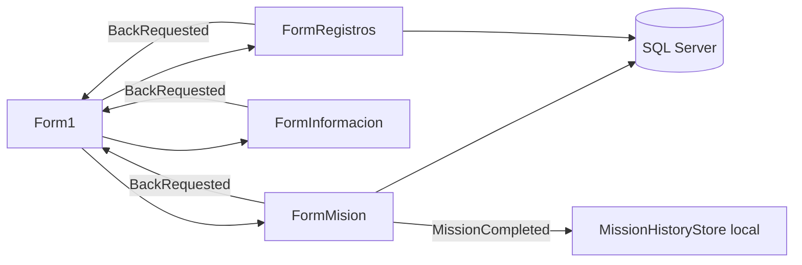

# Arquitectura actual de NEXUS

## Alcance

La aplicación principal es `NEXUS_WindowsForms`, un proyecto C# Windows Forms dirigido a `net10.0-windows`. La solución activa es `NEXUS.slnx` y contiene ese proyecto. El prototipo de consola `nexus1.2mrj.csproj` y las soluciones antiguas se conservan aparte; no son dependencias de la aplicación principal.

## Componentes

| Archivo o tipo | Responsabilidad |
|---|---|
| `NEXUS_WindowsForms/Program.cs` | Inicializa WinForms y ejecuta `NexusApplicationContext`. |
| `NexusApplicationContext` | Conserva una instancia de cada formulario y coordina navegación, retorno al menú, cierre y resultado de misión. |
| `Form1` | Menú principal y eventos de navegación. Los recursos visuales proceden de `Properties.Resources`. |
| `FormMision` | Interfaz de misión, ciclo de actualización del juego, teclado, acciones de misión, guardado y carga SQL. |
| `ExplorationView` | Dibuja y actualiza el mapa 2D; gestiona movimiento, colisiones, habitaciones, puertas, inventario, objetos, enemigos, diálogos, eventos y desafíos. |
| `MissionGame` | Etapas narrativas, decisiones principales, recursos, progreso y desenlaces. |
| `NexusNarrative`, `WorldChallengeCatalog`, `NexusEncyclopedia` | Datos de diálogos/objetivos, eventos/desafíos y enciclopedia. |
| `MissionResult`, `ExplorationSaveState`, `EnemySaveState` | Modelos de resultados y estado serializable de la expedición/exploración. |
| `DatabaseService` | Acceso ADO.NET mediante `Microsoft.Data.SqlClient`; guarda y carga expediciones y consulta resultados SQL. |
| `MissionHistoryStore` | Escribe una copia local JSON de resultados completados bajo el perfil del usuario. |
| `FormRegistros` | Consulta `DatabaseService` y presenta el historial SQL y sus detalles. |
| `FormInformacion`, `NexusTheme` | Enciclopedia navegable y estilo compartido de la interfaz. |

## Navegación

`NexusApplicationContext` crea una instancia de `Form1`, `FormMision`, `FormInformacion` y `FormRegistros`. Los eventos de cada pantalla llevan al menú o a la pantalla solicitada; el contexto oculta las otras instancias para conservar una sola ventana activa. Al abrir los registros, el formulario vuelve a consultar SQL Server.

## Exploración y controles

La vista se dibuja mediante GDI+ en un control personalizado, no mediante un motor externo ni controles separados por cada objeto del mapa. La estación tiene seis zonas conectadas, cámara, minimapa, mobiliario con colisiones, puertas con requisitos, coleccionables, documentos, terminales, enemigos, combate, eventos y desafíos.

`FormMision` dirige el teclado: WASD/flechas mueven; `E` interactúa; `I` abre el inventario; `J` muestra objetivos; `1`–`4` responden a desafíos. El disparo se activa con clic izquierdo o con el botón en pantalla. `F11` alterna pantalla completa y `Esc` vuelve al modo ventana.

## Persistencia actual

`DatabaseService` usa `Microsoft.Data.SqlClient` y las tablas `Cadetes`, `Expediciones`, `EstadoNave`, `DecisionesExpedicion` y `BitacoraMisiones` definidas por `database/01_CreateDatabase.sql`. `database/02_AddExplorationSave.sql` añade `EstadoExploracionJson` a `EstadoNave`; el servicio también agrega esa columna si no existe.

El guardado de una partida en curso se realiza con una transacción SQL e incluye etapa, recursos, banderas de ruta y decisiones; el estado de exploración se serializa a JSON en `EstadoExploracionJson`. Este JSON contiene posición del jugador, habitaciones exploradas, objetos, objetivos, puertas, eventos/desafíos, diálogos y estado de enemigos. La actividad programa un guardado automático cuando transcurren 1,2 segundos sin nuevos cambios; también hay guardado manual y una lista de partidas `EnCurso` para cargar.

Al finalizar, `FormMision` inserta el resultado en `BitacoraMisiones` y actualiza el estado de la expedición. También emite `MissionCompleted`; el contexto entrega ese resultado a `MissionHistoryStore`, que conserva JSON local en `%LOCALAPPDATA%\NEXUS\mission-history.json`. La pantalla de registros obtiene el historial desde SQL Server, no desde ese JSON local.

## Recursos y dependencias

Las tres imágenes PNG de `NEXUS_WindowsForms/Resources/` están referenciadas por `Properties/Resources.resx`. `ExplorerSpriteSheet` dibuja sprites provisionales desde código. El paquete NuGet directo es `Microsoft.Data.SqlClient` 7.1.2; sus dependencias transitivas se restauran automáticamente.

## Límites conocidos

- SQL Server debe estar accesible para guardar/cargar partidas y consultar el historial.
- La cadena de conexión predeterminada usa la instancia local `localhost\SQLEXPRESS`; si el servidor o la instancia tienen otro nombre, debe configurarse `NEXUS_SQL_CONNECTION_STRING`.
- El resultado completado se copia también al JSON local, pero la vista de registros usa la base SQL. Si falla la escritura SQL, el JSON puede conservarlo mientras que no aparece en esa vista.
- `NEXUS.slnx` no incluye el prototipo de consola. Las soluciones antiguas tienen referencias a rutas no presentes en la estructura actual.
- No hay un proyecto de pruebas automatizadas dentro de la solución activa.
