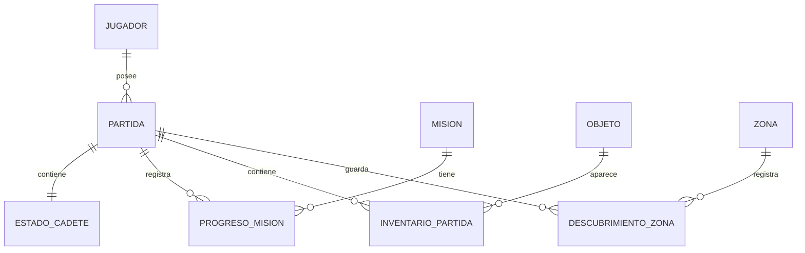

# Modelo de datos propuesto — SQL Server

## 1. Propósito

Guardar y recuperar el progreso de NEXUS. Este esquema es una propuesta futura; no implica que SQL Server ya esté conectado al proyecto H3.

## 2. Entidades y relaciones

- **Jugador:** identidad local o perfil del usuario. Si el juego es individual y no requiere cuentas, puede omitirse inicialmente.
- **Partida:** un progreso guardado, fecha de creación/actualización, nombre y zona actual.
- **EstadoCadete:** vida, energía y experiencia actuales de la partida.
- **Mision:** definición estable de una misión y su descripción.
- **ProgresoMision:** estado de los objetivos de una misión en una partida.
- **Objeto:** catálogo de objetos y su tipo/poder.
- **InventarioPartida:** objetos que tiene una partida y cantidad de cada objeto.
- **Zona:** catálogo de zonas.
- **DescubrimientoZona:** estado de descubrimiento o acceso de una zona dentro de una partida.

## 3. Tablas sugeridas

### `Jugador`
- `JugadorId INT IDENTITY PRIMARY KEY`
- `Nombre NVARCHAR(80) NOT NULL`
- `FechaCreacion DATETIME2 NOT NULL DEFAULT SYSUTCDATETIME()`

### `Partida`
- `PartidaId INT IDENTITY PRIMARY KEY`
- `JugadorId INT NULL` — FK a Jugador si se usa perfil.
- `Nombre NVARCHAR(100) NOT NULL`
- `ZonaActualId INT NULL` — FK a Zona.
- `FechaCreacion DATETIME2 NOT NULL DEFAULT SYSUTCDATETIME()`
- `FechaActualizacion DATETIME2 NOT NULL DEFAULT SYSUTCDATETIME()`
- `VersionEstado ROWVERSION`

### `EstadoCadete`
- `PartidaId INT PRIMARY KEY` — FK a Partida.
- `NombreCadete NVARCHAR(80) NOT NULL`
- `Vida INT NOT NULL CHECK (Vida BETWEEN 0 AND 100)`
- `Energia INT NOT NULL CHECK (Energia BETWEEN 0 AND 100)`
- `Experiencia INT NOT NULL CHECK (Experiencia >= 0)`

### `Mision`
- `MisionId INT IDENTITY PRIMARY KEY`
- `Codigo NVARCHAR(40) NOT NULL UNIQUE`
- `Nombre NVARCHAR(120) NOT NULL`
- `Descripcion NVARCHAR(500) NULL`

### `ProgresoMision`
- `PartidaId INT NOT NULL` — FK a Partida.
- `MisionId INT NOT NULL` — FK a Mision.
- `LlegoAnomalia BIT NOT NULL DEFAULT 0`
- `NucleoEncontrado BIT NOT NULL DEFAULT 0`
- `Sobrevivio BIT NOT NULL DEFAULT 0`
- `Regreso BIT NOT NULL DEFAULT 0`
- PK compuesta (`PartidaId`, `MisionId`).

Para la misión actual de H3, los cuatro campos representan exactamente las condiciones de `Mision`. Si el juego incorpora misiones con objetivos variables, conviene normalizar en tablas `ObjetivoMision` y `ProgresoObjetivo` en una etapa posterior.

### `Objeto`
- `ObjetoId INT IDENTITY PRIMARY KEY`
- `Codigo NVARCHAR(40) NOT NULL UNIQUE`
- `Nombre NVARCHAR(100) NOT NULL`
- `Tipo NVARCHAR(30) NOT NULL`
- `Poder INT NOT NULL DEFAULT 0`

### `InventarioPartida`
- `PartidaId INT NOT NULL` — FK a Partida.
- `ObjetoId INT NOT NULL` — FK a Objeto.
- `Cantidad INT NOT NULL CHECK (Cantidad > 0)`
- PK compuesta (`PartidaId`, `ObjetoId`).

### `Zona`
- `ZonaId INT IDENTITY PRIMARY KEY`
- `Codigo NVARCHAR(40) NOT NULL UNIQUE`
- `Nombre NVARCHAR(100) NOT NULL`
- `Descripcion NVARCHAR(500) NULL`

### `DescubrimientoZona`
- `PartidaId INT NOT NULL` — FK a Partida.
- `ZonaId INT NOT NULL` — FK a Zona.
- `Descubierta BIT NOT NULL DEFAULT 0`
- PK compuesta (`PartidaId`, `ZonaId`).

## 4. Guardar y cargar progreso

**Guardar:** abrir una transacción; insertar/actualizar `Partida`, `EstadoCadete`, progreso de misión, inventario y zonas descubiertas; confirmar la transacción solo si todas las operaciones tienen éxito.

**Cargar:** recuperar la partida por `PartidaId`; cargar estado del cadete, misión, inventario y zonas; reconstruir los objetos de dominio y presentar el estado en los formularios.

**Consistencia:** validar vida/energía y relaciones mediante restricciones de base de datos y reglas de dominio. Usar consultas parametrizadas y manejar errores de conexión. Evitar duplicar el progreso calculable, como porcentaje de misión, si puede obtenerse de los objetivos completados.

## 5. Datos iniciales y seguridad

- Registrar las zonas existentes: Bosque de Cristal, Ruinas de IRIS, Zona de Anomalía y Punto de Extracción.
- Registrar la misión “La anomalía perdida”.
- Registrar los tipos de objeto compatibles con H3: energía, escudo, ataque y analizador.
- No incluir contraseñas en scripts, README o código público. Para desarrollo, utilizar configuración local fuera de Git; en un entorno administrado, preferir autenticación segura.
- Versionar scripts de creación y cambios de esquema para que otra persona pueda reproducir la base.
